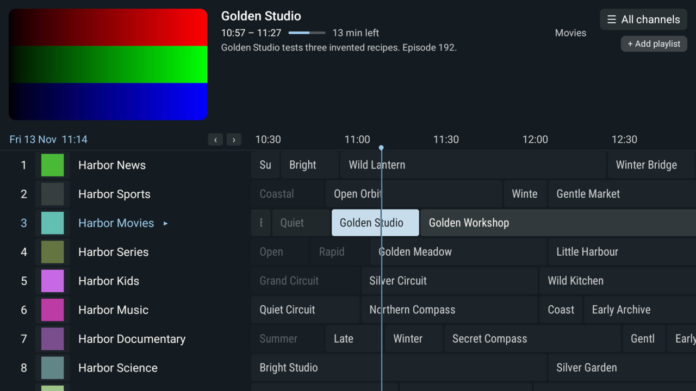
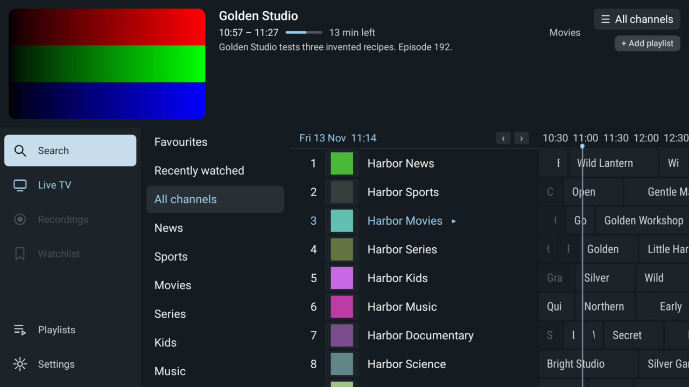
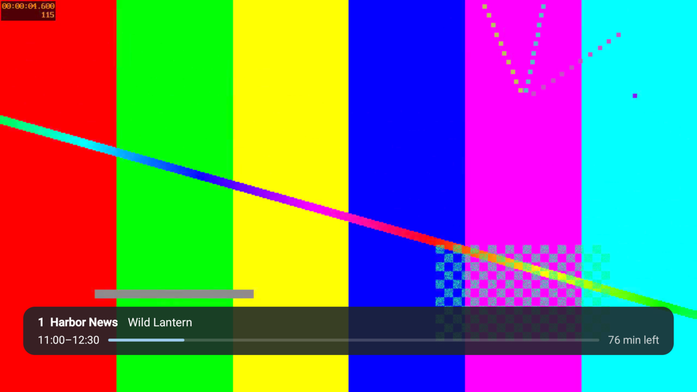
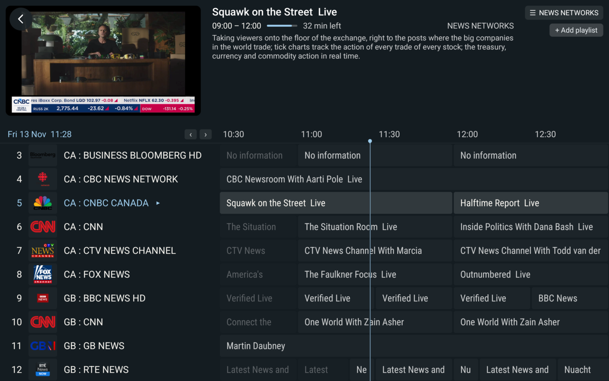

# Patina IPTV

A bring-your-own-playlist IPTV player for Android TV, Android tablets,
Linux, macOS and iPad, written in Rust on
[Native Shell (NSH)](https://github.com/longbridge/nsh).

Patina is inspired by the TV guide experience of TiviMate on Android TV
and brings that experience to desktops and tablets: a remote-first guide
over live video that works just as well with touch, mouse and keyboard.
Patina is an independent project, not affiliated with TiviMate, and
shares none of its code or artwork.



<table>
  <tr>
    <td></td>
    <td></td>
  </tr>
</table>



<sub>The Android TV screenshots use the repository's synthetic playlist,
guide and test streams. The tablet screenshot shows a real provider's
playlist.</sub>

Patina provides no channels or content. You add the playlist or account
your IPTV provider gave you.

### Why "Patina"

A patina is the finish that metal earns with age and handling, like the
green of weathered copper. Rust is iron's patina, and Patina is written in
Rust. The name also fits the app's look (dark ink surfaces with mineral
accents, and the metal P of its icon) and the way it is meant to be used:
a player that settles into a household's habits through its favourites,
custom groups and history.

## Features

- **Sources:** M3U playlists (by URL or file), Xtream Codes and Stalker
  portals, with several playlists browsable together.
- **Guide:** XMLTV EPG (plain or gzip) with automatic channel matching,
  per-channel guide choice, catch-up playback where the provider offers it.
- **Watching:** guide over live video, channel list beside the video,
  multiview (up to four tiles on desktop, two on Android),
  picture-in-picture on the desktops, track and picture-size choice.
- **Library:** favourites, custom groups, reordering, hiding, history and
  channel/programme search.
- **Resilient live playback:** streams that the provider cuts reconnect
  without dropping to an error screen.
- **Private by default:** the local catalog, including credentials, is
  encrypted with SQLCipher; HTTPS is the default transport. Whole-app
  backup and restore to a `.patinabackup` file.

## Install

Release builds are published on
[GitHub Releases](https://github.com/teng-lin/patina-iptv/releases):

| Platform | Package |
| --- | --- |
| Android TV and tablets (Android 8.0+) | `.apk` |
| Linux x86_64 (glibc 2.39+, GTK 4.14+) | `.deb`, `.rpm`, `.pkg.tar.zst`, `.AppImage` |
| macOS (Apple silicon) | `.dmg` (ad hoc signed, not notarized) |
| iPad | Not released yet; [build from source](#ipad) |

The native Linux packages need the system's GTK 4, libmpv and GStreamer.
The AppImage bundles them.

## Build from source

### Prerequisites

- Rust (the version pinned in `rust-toolchain.toml`) with the
  `wasm32-unknown-unknown` target, and for Android also
  `aarch64-linux-android` and `x86_64-linux-android`.
- The NSH fork checked out next to this repository and its CLI built:

  ```sh
  git clone -b tv-keys https://github.com/teng-lin/nsh.git ../nsh
  (cd ../nsh && cargo build --release -p nsh-cli)
  ```

- **Linux:** GTK 4 and libmpv 2 (`mpv` on Arch, `libmpv-dev` on
  Debian/Ubuntu).
- **macOS:** Xcode command line tools and `brew install mpv`.
- **Android:** JDK 21, Android SDK (platform 35, build-tools 35.0.1), NDK 30.
- **iPad:** Xcode. `tools/fetch-mpvkit.sh` downloads the libmpv build.
- `python3` and `ffmpeg` for the synthetic test streams.

### Run

```sh
cargo run -p iptv-app            # Linux or macOS desktop
```

Android:

```sh
tools/sync-host.sh               # builds libnsh.so into the Android host
(cd hosts/android && ./gradlew assembleDebug)
adb install -r hosts/android/app/build/outputs/apk/debug/app-debug.apk
```

#### iPad

The iPad app is complete and runs on devices, but it is not yet
distributed. It plays video through the same libmpv player as the
desktops (MPVKit's LGPL build) and adds touch navigation of its own.

```sh
tools/fetch-mpvkit.sh            # libmpv xcframeworks, checksums pinned
cd crates/iptv-app
nsh package . --target ios-simulator -o ../../target/ios-sim
nsh package . --target ios -o ../../target/ios \
  --sign <signing identity SHA-1> --profile <app.mobileprovision>
xcrun devicectl device install app --device <id> ../../target/ios/Patina.app
```

Installing on a device needs Developer Mode on the iPad and a development
profile for `com.hantekllc.iptvrs`.

Desktop packages: `tools/ci/package-linux.sh` and `tools/package-macos.sh`.

### Try it with synthetic data

The repository has no real provider data. Local mock servers stand in:

```sh
python3 -I tools/make-iptv-fixtures.py --host 127.0.0.1:8089
tools/make-hls-fixtures.sh --serve &      # playlist, EPG and HLS on :8089
IPTV_RS_DEV_PLAYLIST=http://127.0.0.1:8089/iptv/playlist.m3u cargo run -p iptv-app
```

Use `10.0.2.2` instead of `127.0.0.1` from an Android emulator. Other
mocks: `tools/mock-xtream.py` (Xtream API), `tools/mock-live-cuts.py`
(live streams the server keeps cutting), `tools/make-track-fixtures.sh`
(multiple audio and subtitle tracks).

## Keyboard

| Remote | Keyboard |
| --- | --- |
| D-pad, OK | Arrows, Enter |
| Back | Escape |
| Menu | `m` |
| Channel up / down | Page Up / Page Down |
| Play / pause | Space |
| Info, Guide | `i`, `g` |
| Previous channel | `p` |
| Rewind / fast-forward (catch-up) | `[`, `]` |
| Search | `/` or Ctrl+F (Cmd+F) |
| Volume, mute | Ctrl+Up / Ctrl+Down (Cmd on macOS), Ctrl+M |
| Full screen | F11 (Ctrl+Cmd+F on macOS) or double-click the video |

## Development

| Path | What |
| --- | --- |
| `crates/iptv-core` | UI-independent state: guide model, focus, lists, panels, menus |
| `crates/iptv-nav` | Remote keys, long presses, key-to-action map |
| `crates/iptv-settings` | Settings schema, store and backup JSON |
| `crates/iptv-providers` | M3U parser, Xtream and Stalker clients |
| `crates/iptv-epg` | XMLTV parser and channel matching |
| `crates/iptv-guide` | Guide schedule and stream resolution |
| `crates/iptv-import` | Source and guide import pipeline |
| `crates/iptv-search` | Channel and programme search |
| `crates/iptv-net` | HTTP adapter (reqwest + rustls) |
| `crates/iptv-store-sqlite` | Encrypted SQLite store |
| `crates/iptv-app` | NSH app: screens, theme, video layer (libmpv on desktop and iPad) |
| `hosts/android` | Kotlin host with the Media3 player |
| `tools/` | Mock servers, fixtures, packaging and CI scripts |

All crates except `iptv-app`, `iptv-net` and `iptv-store-sqlite` are
sans-IO and build for `wasm32-unknown-unknown`.

Run every check before committing:

```sh
tools/check.sh
```

The app's scenario tests in `crates/iptv-app/tests/app/` run the whole app
headless, each in its own process with an empty `$HOME`.
`cargo test -p iptv-app --features test-support <name>` runs one.

Useful environment variables: `IPTV_RS_AUDIO=null` (mute),
`IPTV_RS_HWDEC` (mpv `hwdec`), `RUST_LOG=info` (player state, never stream
addresses).

Project rules for contributors and coding agents are in
[AGENTS.md](AGENTS.md). Release and signing setup is in
[docs/release.md](docs/release.md). The storage and transport security
model is in [docs/security.md](docs/security.md).

`python3 tools/bump-version.py patch` bumps the version. A `v<version>`
tag builds and publishes the release.

## License

[AGPL-3.0-only](LICENSE). Bundled Roboto fonts are under the
[SIL Open Font License](crates/iptv-app/fonts/OFL.txt). Packages that
bundle FFmpeg and mpv carry their licences too.
